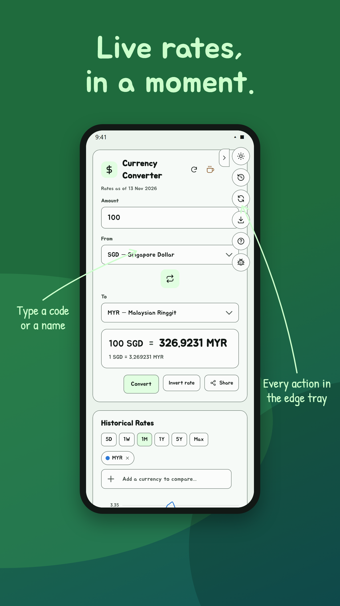
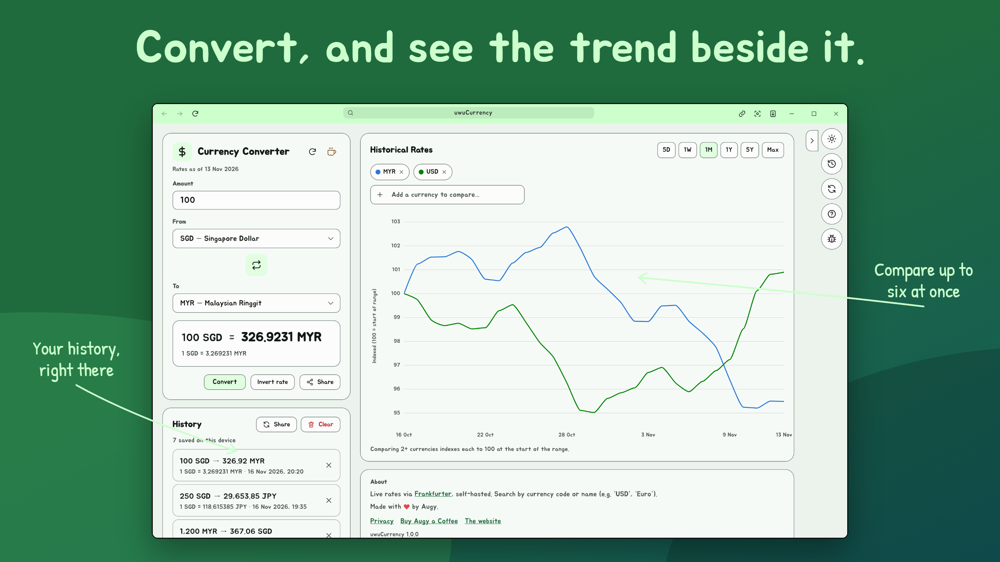

# uwuCurrency

A simple currency converter with live exchange rates, rate graphs and a history of your
conversions you can share between your devices. By UwU Apps (Augy Studios).

uwuCurrency is a website (a PWA) at <https://currency.uwuapps.org>, and an app for Android,
Windows, macOS and Linux. It was the Currency Converter; from 1.0.0 the apps are called
uwuCurrency.

**Download the apps:** <https://github.com/augy-studios/currency-converter/releases/latest>

| Phone | Desktop |
| --- | --- |
|  |  |

## Features

- **Live rates**: type an amount and pick two currencies, by code (USD) or name (Euro). Swap
  them, turn the rate round, and see the day the rate is from.
- **Rates over time**: 5 days to every day there is, for up to six currencies at once, each
  indexed to 100 so their changes line up.
- **History**: every conversion that settles is kept on the device, newest first. Tap one to
  convert it again; remove one or clear them all.
- **Share with another device**: copy history and the theme straight to another phone, tablet
  or computer with a code or QR code, over WebRTC (STUN only, `docs/STUN-p2p-spec.md`). No
  account, no server in between.
- **Share a conversion**: Telegram, WhatsApp, X, Facebook, the system's share sheet, or a picture.
- **Report a bug**: from the edge tray, with up to three pictures (including a screenshot of the
  whole page), to a Telegram bot ([BUG-REPORT-SETUP.md](BUG-REPORT-SETUP.md)). Each report gets an
  ID, like `20261116-7K3Q`.
- **API Docs**: a button in the edge tray, on the site and in every app, opens the API's
  documentation site (`docs-site/`, docs.api.currency.uwuapps.org) in the browser.
- **Tours**: Show me around, the first time and from the tray; each step scrolls to what it shows.
- **Themes**: seven colours, light, dark or time-based. The apps add Material You (Android) or the
  system's own glass (desktop: Fluent 2, macOS Tahoe, Deepin and COSMIC frosted glass).
- **Works offline**: the last rates are kept, on the site and in the apps.

## The apps

One Flutter project (`flutter/`) builds Android and the three desktop apps, with every feature the
website has, under the same storage keys and API (`flutter/PORTING.md` maps each part of the site
to its Dart). The specs they follow are in `docs/`: `flutter-android-app-spec.md`,
`flutter-desktop-app-spec.md` and `desktop-features-spec.md`.

- **Android** (`org.uwuapps.currency`): Material You by default, with the site's UwU Apps look a
  switch away in Theme; an Updates page in Material You listing every version, updating itself
  from GitHub Releases with a Material You wavy progress bar; notifications of new versions through
  Firebase ([flutter/FIREBASE-SETUP.md](flutter/FIREBASE-SETUP.md)); text like "50 USD" shared from
  any app opens in the converter. Also on Google Play ([GOOGLE-PLAY.md](GOOGLE-PLAY.md)).
- **Windows, macOS and Linux**: their own title bar and command bar (`Ctrl+K`: type "100 usd to
  eur"), the converter and the graph side by side, the tray with a tray rate, desktop rate widgets,
  the Jump List and Dock, screenshots, a pointing hand on everything pressable, and self-updating
  installers built by GitHub Actions. Their second look, in place of Material You, is the system's
  glass: Fluent 2 with a painted Mica-like backdrop (Windows), the desktop through the window
  (macOS), or a frosted backdrop (Linux), always in the system's accent colour.
- No ads and no analytics in the apps. The website keeps its Google Analytics (and its ads).

### Build them

Needs Flutter 3.47, a JDK 17 or later and the Android SDK, and in `flutter\`: `android.keystore`
with `keystore.properties` (the signing key, **back them up**: an APK signed with any other key
can't update the app people have) and `android\app\google-services.json` (Firebase). All three are
kept out of git.

```powershell
powershell -ExecutionPolicy Bypass -File flutter\build-apk.ps1          # uwucurrency-<v>.apk, for GitHub
powershell -ExecutionPolicy Bypass -File flutter\build-apk.ps1 -Aab     # uwucurrency-<v>.aab, for Play
```

Both are shrunk and obfuscated as Google Play asks: R8 shrinks and renames the Java and removes
unused resources, the Dart is obfuscated with its symbols split off, and emulator-only libraries
are left out of the APK. What reads a crash report back stays beside them in `release/<version>/`
and is never shared: `-mapping.txt` (R8) and `-symbols.zip` (Dart, for `flutter symbolize`).

**The version code goes up by one on every build**, APK or bundle (the `+N` in
`flutter/pubspec.yaml`'s `version:`): Play refuses a code it has seen, and a phone only takes a
higher one as an update. Commit `pubspec.yaml` with the build. For a new version, raise the name
yourself (`1.0.0` → `1.0.1`); every platform shares it.

The desktop apps build on GitHub's machines (`.github/workflows/build-desktop.yml`) when a release
is published. To try one here: `cd flutter; flutter run -d windows` (or `macos`, `linux`).

### Releasing

```text
release/1.0.0/
  uwucurrency-1.0.0.apk                  Android      flutter\build-apk.ps1
  uwucurrency-1.0.0.aab                  Google Play  flutter\build-apk.ps1 -Aab (never on a GitHub release)
  uwucurrency-1.0.0-mapping.txt          Android      for reading crashes; never shared (git-ignored)
  uwucurrency-1.0.0-symbols.zip          Android      the Dart side's symbols, the same (git-ignored)
```

The APK and App Bundle are committed with the code they were built from. Any file over GitHub's
100 MB limit is git-ignored by name and goes only on the GitHub release. The desktop installers
(`-setup.exe`, `.msi`, `-mac-*.dmg/.zip`, `.deb`, `.rpm`, `.AppImage`) and their `latest*.yml`
update files are built by GitHub Actions and go only on the release.

1. Build the APK (and the bundle, for Play). Commit and push, so the release points at the code it
   was built from.
2. Create the release with the tag **`android-v<version>`** (the Android updater and the site's
   `api/app-release.js` look for that pattern), titled `uwuCurrency <version>`, its description
   `announcements/release-notes-<version>.md`.
3. Attach the APK **before** publishing (the "new version" notification is sent the moment it's
   published, and a release without its APK is skipped). Mark it the latest, and publish.
4. A few minutes later, GitHub Actions adds the desktop installers and update files.
5. Post `announcements/announcement-<version>.md` in the UwU Apps Telegram channel, and paste
   `announcements/play-release-notes-<version>.md` into Play Console.

A **desktop-only** version (no change for Android) goes the same way with no APK: raise the
version name in `pubspec.yaml` (not the build number), push, and publish the release with nothing
attached, marked the latest. The desktop apps update from the latest release's `latest*.yml`, while
Android's updater and `api/app-release.js` skip a release without an APK, so phones stay on the
last version that had one. Its release notes say where that APK is.

`announcements/` holds, for each version: `release-notes-<version>.md` (GitHub; the Android
Updates page reads its first paragraph as the summary and each `###` group's `- **Title**: text`
lines as cards, so keep to that shape), `announcement-<version>.md` (Telegram, plain text, short
lines) and `play-release-notes-<version>.md` (Play, 500 characters). All in en-GB.

## Repository layout

```text
main-site/          The website, deployed to Vercel (main-site/README.md)
flutter/            The Android, Windows, macOS and Linux apps
  FIREBASE-SETUP.md   Notifications of new versions
  PORTING.md          Each part of the site and its Dart
  e2e/                The app and the site in a browser, driven by Playwright
  tool/make_icons.py  Every icon, from docs/assets/uwucurrency-icon.svg
telegram-bot/       @uwucurrency_bot, the converter on Telegram (telegram-bot/README.md)
docs-site/          The API's documentation site (docs-site/README.md)
release/            The built APK and App Bundle, each version in a folder
announcements/      Release notes for GitHub and Google Play, and Telegram announcements
docs/               Specs, the icon's source, and Google Play's images
  phone-assets/, tablet-assets/, desktop-assets/, feature-graphic.png
scripts/            bug-report-test.cjs: the bug report function, with Telegram stood in for
.github/workflows/  Build desktop apps: the installers, on every release
```

## Tests

```powershell
node scripts/bug-report-test.cjs                 # Report a bug's server side
cd flutter
flutter analyze
flutter test                                     # the logic ported from the site, against its answers
cd e2e; npm ci; npx playwright install chromium
npm run build                                    # the app for a browser
npm test                                         # the app and the site (site.spec.js)
```

`flutter/e2e/tests/site.spec.js` drives the website itself: history, sharing it between two
browsers over the real PeerJS broker, the tours, Report a bug and Privacy. The other specs drive
the app's browser build with the API answered from `fixtures.js`. `npm run shots` (in
`flutter/e2e`) redraws Google Play's images from the same build.

## Deploying the site

Deploy `main-site/` as a Vercel project: `main-site/README.md` has its environment variables
(all optional) and what each does. Every change to a file the service worker caches must bump
`VERSION` in `main-site/sw.js`.

## Contributing

Please read the [Code of Conduct](CODE_OF_CONDUCT.md) before taking part.

## License

[MIT](LICENSE) © 2024–2026 Augy Studios
